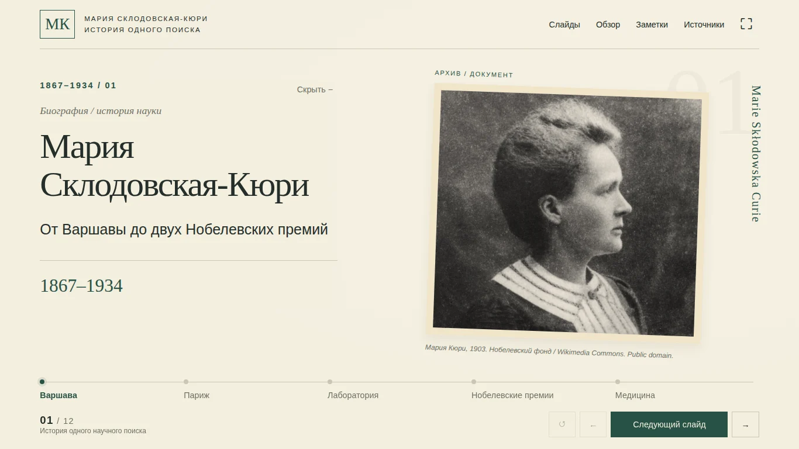

# Мария Склодовская-Кюри

**От Варшавы до двух Нобелевских премий**

Интерактивная история в 12 слайдах на русском языке. Ориентир выступления — 15 минут с паузами и обсуждением.

[Открыть презентацию](https://xondell.github.io/marie-curie-interactive/) · [Полный текст презентации и речи](Marie_Curie_Presentation_Text_RU.md) · [Источники и права](Sources_and_Credits.md)

## Содержание

| Слайд | Тема | Время |
| --- | --- | --- |
| 1 | Мария Склодовская-Кюри | 0:45 |
| 2 | Варшава. Как получить образование? | 1:05 |
| 3 | Париж. От студентки к исследовательнице | 1:10 |
| 4 | Загадка урановой руды | 1:20 |
| 5 | Охота за неизвестными элементами | 1:50 |
| 6 | От руды к кристаллам | 1:20 |
| 7 | Первая Нобелевская премия | 1:05 |
| 8 | Продолжить работу | 0:55 |
| 9 | Вторая Нобелевская премия | 1:15 |
| 10 | «Маленькие Кюри» на фронте | 1:35 |
| 11 | Излучение в медицине | 1:25 |
| 12 | От одного наблюдения — к новой науке | 1:15 |

## Как показывать

- **Зелёная кнопка, пробел или →**: следующее раскрытие, затем следующий слайд.
- **←**: предыдущее раскрытие, затем предыдущий слайд.
- **Page Down / Page Up**: следующий / предыдущий слайд без перебора раскрытий.
- **M**: содержание. **H**: скрыть или вернуть текст. **R**: сбросить текущий слайд.
- **F**: полный экран. **N**: заметки. **Escape**: закрыть окно или вернуть скрытый текст.
- **Home / End**: первый / последний слайд.
- **«Обзор»** раскрывает все элементы. **«Показ»** возвращает сохранённые шаги.

Заметки в окне презентации видны на демонстрируемом экране. Для подготовки отдельно используйте [MD-файл с экранными текстами и полной речью](Marie_Curie_Presentation_Text_RU.md).

Прямая ссылка на слайд: например, [лабораторный опыт, слайд 4](https://xondell.github.io/marie-curie-interactive/#4).

## Автономная версия

Скачайте [index.html](index.html) с помощью кнопки **Download raw file** в GitHub и откройте в браузере. Все изображения, стили и код встроены в один файл. Установка, аккаунты, сервер и подключение к сети для показа не нужны. Внешние ссылки раздела «Источники» открываются через интернет.

## Интерактивные эпизоды

Сравнение урана и руды, выбор активной пробирки, цикл выделения соли радия, сравнение двух премий и поиск условного осколка на учебной схеме. Предусмотрены подсказки при неверном выборе и сбросы.

Лабораторные сигналы условные, без числовых измерений. Схема предплечья учебная. Передвижной рентгеновский аппарат и лучевая терапия представлены как разные применения излучения.

## Источники и фотографии

Содержание основано на предоставленном сценарии, материалы сопоставлены с Nobel Prize и Musée Curie. Фотографии сопровождаются архивными подписями.

Портрет и две фотографии Wikimedia Commons имеют отметку public domain. Фотографии Сорбонны и Института радия: **Musée Curie (coll. ACJC)**, некоммерческое использование с атрибуцией по условиям музея. См. [источники и условия](Sources_and_Credits.md). Весь репозиторий не объявляется под единой свободной лицензией.

## Проверка и публикация

Презентация проверена в Chrome: интерактивные состояния, клавиатура, полный экран, автономная работа, размеры 1366×768, 1920×1080 и 390×844, показ со скрытой и открытой панелью текста. Показ на физическом проекторе и другие браузеры отдельно не проверялись.

GitHub Pages публикует корень ветки `main`. Файл `.nojekyll` оставляет HTML без обработки Jekyll. Для изменения содержания достаточно отредактировать `index.html` и отправить изменения в `main`.
